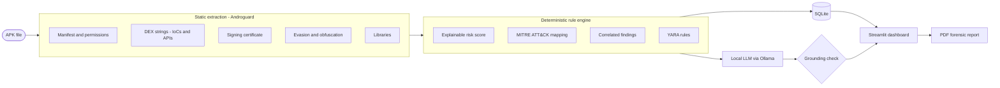
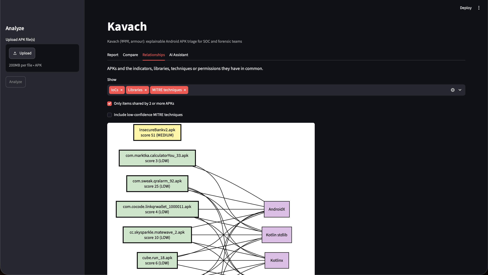
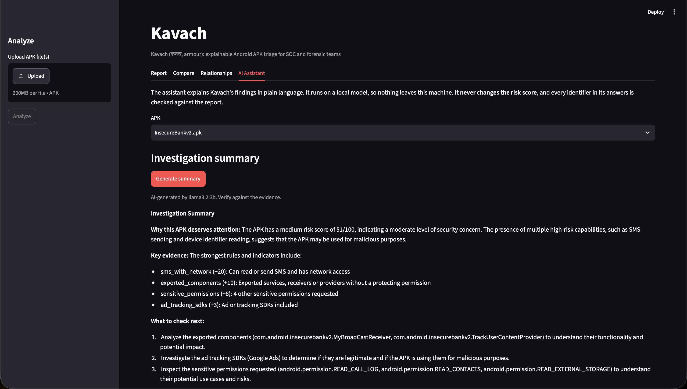

<div align="center">

# Kavach

### Explainable Android APK triage for SOC and forensic teams

*Kavach (कवच) means armour.*

[](https://github.com/gaurav-11-cyber/Cyber-Hackathon/actions/workflows/tests.yml)


</div>

---

## The problem

A suspicious APK lands on an analyst's desk. Obfuscation, runtime code loading, hidden payloads, anti-emulator
checks and excessive permissions are all used to hide what it does, and the evidence is scattered across
separate tools. The analyst has to run each tool, copy results around, and still decide which APK to look at first.

## What Kavach does

Drop in one or many APKs. Kavach reads each one **without ever running it** and gives the analyst:

| You give | You get |
|---|---|
| An APK (or several) | **Risk score from 0 to 100 where every point has a named rule and evidence** |
| | IoCs: URLs, public IPs, hosts. Signing certificate and library analysis |
| | Evasion findings: code loading, anti-debugging, anti-emulator, hidden payloads |
| | **Behavioural capabilities** from sensitive API usage, checked against declared permissions |
| | MITRE ATT&CK for Mobile mapping with a confidence level |
| | **Correlated findings**: combinations that matter more than any single alert |
| | Direct links versus weak similarities across APKs, and a relationship graph |
| | A generated YARA rule, a PDF forensic report, and optional hash lookup |
| | **An AI assistant** that explains all of it in plain language |

## Why Kavach is different

**1. Every point is explained.** The score is not a black box. Each rule that fires shows its points,
its reason and its evidence. An analyst can disagree with a rule, but never wonder where a number came from.

**2. The AI is not allowed to bluff.** A local language model writes the investigation summary and answers
analyst questions, but it **never changes the score**, and every identifier in its answer (rule names, MITRE IDs,
IPs, hosts, permissions, even the score itself) is checked against the real report. Anything the report does not
contain is flagged **unverified** on screen. The model runs on the analyst's own machine, so no APK data leaves it.

**3. Tuned on real apps, not just toy data.** Early versions flagged normal apps as risky. We tested on real
apps, found the causes, fixed them and locked each fix in with a regression test (details below).

**4. Honest about its limits.** What is not built, and what is not validated, is written down in this README.

## How it works



The deterministic engine decides. The AI only explains, and its words are verified against the engine's output.

## Screenshots

| Report | Compare | Relationships |
|---|---|---|
|  |  |  |

| AI Assistant | PDF report |
|---|---|
|  |  |

## See the score explained

Real output from analysing **InsecureBankv2**, a deliberately vulnerable training app (not malware):

```
Risk score 56 / 100 - MEDIUM

  +20  sms_with_network       SEND_SMS permission together with network access
  +10  exported_components    MyBroadCastReceiver, TrackUserContentProvider (no protecting permission)
  +10  dynamic_code_loading   DexClassLoader
  + 8  sensitive_permissions  READ_CALL_LOG, READ_CONTACTS, storage
  + 5  legacy_signing         only the legacy v1 signing scheme
  + 3  ad_tracking_sdks       Google Ads
```

The score says how much analyst attention an APK deserves. It does not claim that an app is malicious.

## The AI assistant

| Feature | What it does |
|---|---|
| **Investigation summary** | Why the APK deserves attention, the strongest evidence, and what to check next |
| **Copilot** | Answers questions such as "Why is this rated high?" using only the report |
| **Multi-APK explanation** | Explains direct links versus weak similarities between APKs |
| **Grounding check** | Flags any rule, technique, IP, host, permission or score in the answer that is not in the report |
| **Safe fallback** | If the model is not running, a rule-based summary is shown and everything else keeps working |

Every AI output is labelled as AI-generated. The prompt forbids guessing what a finding "could be used for".
A small local model can still be vague or wrong, so treat its text as a draft for the analyst.

## Quick start

```bash
git clone https://github.com/gaurav-11-cyber/Cyber-Hackathon.git
cd Cyber-Hackathon
python3 -m venv .venv
source .venv/bin/activate
pip install -r requirements.txt
streamlit run app.py
```

Upload one or more APKs in the sidebar and press **Analyze**. Results are kept in a local SQLite file (`kavach.db`).

<details>
<summary><b>Command line, AI model, hash lookup and tests</b></summary>

**Command line**

```bash
python analyze.py samples/app.apk                 # full JSON report
python analyze.py samples/*.apk --summary         # one row per APK
```

**AI assistant (optional, free, offline)**

```bash
ollama pull llama3.2:3b        # a small model that fits in 8 GB of RAM
```

Keep the Ollama app running and open the **AI Assistant** tab. Set `OLLAMA_MODEL` to use another model.
Without Ollama, everything else works.

**Hash lookup (optional)**

```bash
cp .env.example .env     # add your own free VT_API_KEY and/or MB_AUTH_KEY
```

Only the SHA-256 hash is ever sent, never the file.

**Tests**

```bash
pip install -r requirements-dev.txt
python -m pytest -q
```

</details>

## PS-02 coverage

| Requirement | Status | What is there |
|---|---|---|
| Static, manifest and resource analysis | ✅ Done, resources partial | Manifest, permissions, exported components, DEX strings, asset files. Resource files are not analysed in depth |
| Dynamic behavioural analysis | ❌ Not implemented | Planned. Kavach is a safe static triage tool first, and never executes a sample |
| Permission, API and evasion analysis | ✅ Done | Permissions, API-usage capabilities checked against declared permissions, obfuscation, dynamic loading, anti-debugging, anti-emulation, hidden payloads |
| Network, certificate and library analysis | ✅ Done, CVE matching missing | URLs, IPs, hosts, signing certificate, libraries. Library versions are not matched to known CVEs |
| Threat intelligence and risk scoring | ⚠️ Partly | Explainable score and MITRE mapping are done. Hash lookup (VirusTotal, MalwareBazaar) is implemented and tested with mocked responses. Lookup of individual IoCs is not done |
| Investigation dashboard and reports | ✅ Done | Multi-APK comparison, relationship graph, direct versus weak links, PDF forensic report with evidence, YARA export |
| AI assistance | ✅ Done, no ML classifier | Local-model assistant with grounding check. The score is rule-based, not machine learning |

## Validation, and what we fixed along the way

Kavach was run on **9 real open-source apps** plus **InsecureBankv2**, a deliberately vulnerable banking app
used to train security students (not malware). Final scores:

| APK | Score | Level | Top findings |
|---|---|---|---|
| InsecureBankv2.apk (training app) | 51 | MEDIUM | SMS access with network, exported components, runtime code loading |
| io.github.xtratter.appshelf | 27 | LOW | install permission, external hosts, persistence |
| com.sweak.qralarm | 25 | LOW | exported components, external hosts, persistence |
| de.clio.audiobook | 24 | LOW | exported components, external hosts |
| cc.skysparkle.matewave | 10 | LOW | external hosts, sensitive permissions |
| cube.run | 6 | LOW | external hosts, hooking-framework detection |
| com.thomaspeoples.wraithodysseus | 6 | LOW | external hosts, hooking-framework detection |
| com.cocode.linkqrwallet | 4 | LOW | external hosts, sensitive permissions |
| com.marktka.calculatorYou | 3 | LOW | hooking-framework detection |

Only the training app, which was built with intentionally exploitable components, scored above LOW. Every
other real app stayed LOW. This is the result of several rounds of fixing false positives, each locked in
with a regression test:

| Found on a real app | Cause | Fix |
|---|---|---|
| A web browser scored 100 (CRITICAL), now 26 (LOW) | Noisy domains, private emulator IPs, single stray strings | URL host validation, public-IP only, evidence thresholds |
| A chess app scored MEDIUM (36), now 10 (LOW) | Every web host it mentioned added points | Plain web hosts weigh little. Raw IPs and cleartext weigh more |
| Fake "IP addresses" `3.5.7.7` and `5.38.8.97` | Numbers inside SVG icon path data | An IP counts only as a whole string or `ip:port` |
| An app store scored MEDIUM | Minified code counted as obfuscation | Obfuscation alone is weak. It matters only together with runtime loading |
| An ad SDK reported as a "staged payload" | Loader plus any web host | Needs a hidden payload or a hardcoded public IP |

## Limitations

- **No dynamic analysis.** Code that is encrypted, packed, or loaded at runtime cannot be fully inspected.
- **Not validated against real malware.** The rules and thresholds were tuned on clean apps, one deliberately
  vulnerable app and synthetic test data. Detection of real malware families has not been measured.
- **Rule-based score.** The thresholds are judgement, not a trained model.
- **The AI is a small local model.** The grounding check catches invented identifiers, not weak reasoning.
- **String-based detection can be evaded** and can produce false positives. Use the output for triage, not as a verdict.
- A standalone version number such as `1.2.3.4` can still look like an IP address.
- Generated YARA rules are tested on synthetic DEX data only. Hash lookup is tested with mocked responses.

## Handling malware safely

Kavach reads files. It never runs or installs them. Even so, keep real malware samples in an isolated VM with no
shared folders or clipboard, and never install a sample on a phone or emulator. `samples/` and `*.apk` are
git-ignored on purpose.

## Quality

- **110+ automated tests**, run on every push by GitHub Actions (green badge above)
- Regression tests for every false positive listed in the validation table
- The AI layer is tested with a mocked model, including hallucination detection
- Type-checked, and verified from a fresh clone of this repository

<details>
<summary><b>Project structure</b></summary>

```
app.py               Streamlit dashboard
analyze.py           Command-line entry point
analyzer/
  manifest.py        Package info, permissions, exported components
  iocs.py            URL / IP / host extraction and filtering
  certificate.py     Signing certificate analysis
  evasion.py         Evasion and obfuscation indicators
  capabilities.py    Sensitive API usage versus declared permissions
  libraries.py       Third-party library detection
  scoring.py         Explainable risk scoring
  mitre.py           MITRE ATT&CK for Mobile mapping
  correlate.py       Correlated findings and multi-APK comparison
  ai.py              Local-model assistant with grounding check
  yara_gen.py        YARA rule generation
  report.py          PDF forensic report
  intel.py           VirusTotal / MalwareBazaar hash lookup
  storage.py         SQLite storage
  graph.py           Relationship graph between APKs
tests/               pytest suite
scripts/             Fresh-clone verification
```

</details>

## Roadmap

1. Dynamic analysis in an emulator (network and file activity)
2. Threat-intelligence lookup for extracted domains and IPs
3. CVE matching for detected library versions
4. A machine-learning risk estimate, evaluated separately from the deterministic score
5. Validation on known malware families

## Built with

Python · Androguard · Streamlit · SQLite · YARA · ReportLab · Ollama (local LLM) · pytest · GitHub Actions

---

<div align="center">

Built by **Gaurav Raj** for hackathon problem statement **PS-02: AI-Assisted Android Application Security and Forensic Analysis Platform**

</div>