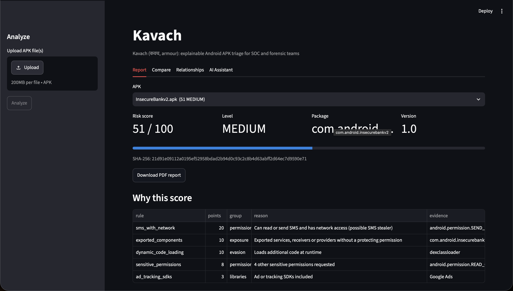
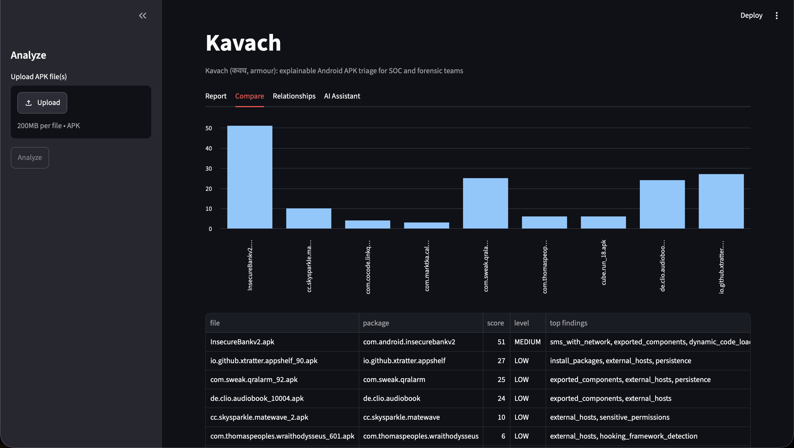
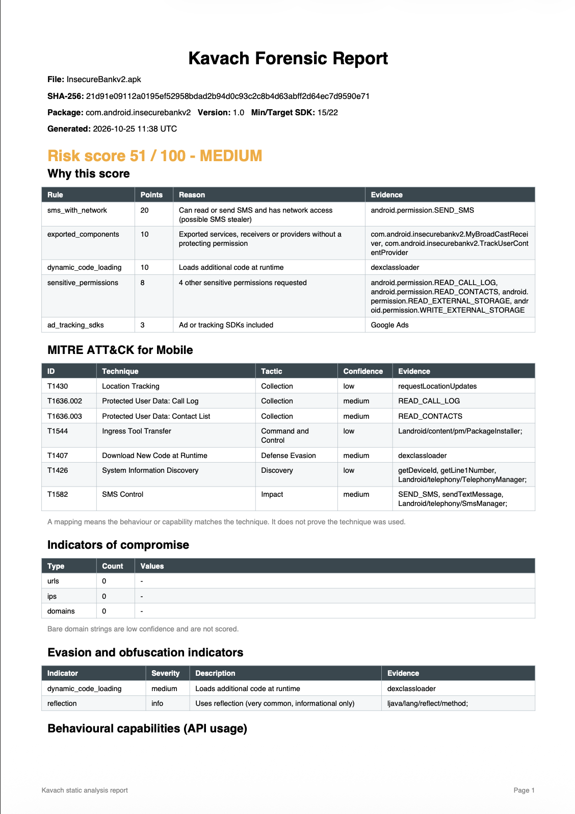

# APKScope

[](https://github.com/gaurav-11-cyber/Cyber-Hackathon/actions/workflows/tests.yml)

**Android APK triage for SOC analysts.** Upload a suspicious APK and get an explainable risk score,
extracted indicators of compromise (IoCs), MITRE ATT&CK for Mobile mapping, correlated findings,
a YARA rule, a PDF report, and an AI assistant that explains the findings in plain language.
A dashboard compares several APKs side by side.

> Built for hackathon problem statement **PS-02: Android Application Security and Forensic Analysis Platform**.

## How the AI is used

The risk score and every finding come from **deterministic, transparent rules**. The AI never decides
anything. It explains.

- **Investigation assistant:** reads the structured findings and writes a short summary: why the APK
  deserves attention, the strongest evidence, and what to check next.
- **Copilot:** answers analyst questions ("Why is this rated high?", "What should I investigate next?")
  using only the report.
- **Multi-APK explanation:** explains direct links versus weak similarities between APKs.
- **Runs locally.** It uses a local model through [Ollama](https://ollama.com), so no APK data leaves the machine.
- **Grounding check.** Every identifier in an AI answer (rule name, MITRE technique, IP, host, permission,
  score) is checked against the report. Anything that is not in the report is shown as **unverified**.
- **Safe fallback.** If Ollama is not running, a rule-based summary is shown instead and the tool keeps working.
- Every AI output is labelled as AI-generated and should be verified against the evidence.

## What it does

| Area | What APKScope provides |
|---|---|
| **Manifest** | Package info, permissions (sensitive ones flagged), exported activities / services / receivers / providers |
| **IoCs** | URLs, public IP addresses and domains found in the DEX code, with noise filtering |
| **Certificate** | Signing schemes (v1/v2/v3), issuer, validity, SHA-256, debug certificate, self-signed, expired |
| **Evasion** | Runtime code loading, anti-debugging, emulator and hooking-framework checks, shell execution, name obfuscation, high-entropy hidden payloads |
| **Libraries** | Third-party libraries detected from class packages, with a category (framework, network, analytics, ads/tracking) |
| **Risk score** | 0-100 score where **every point comes from a named rule with evidence** |
| **MITRE ATT&CK** | Findings mapped to ATT&CK for Mobile techniques, each with a confidence level |
| **Correlated findings** | Rules that spot combinations (for example SMS access plus external hosts, or runtime code loading plus a hidden payload) |
| **YARA** | A rule generated from the APK's IoCs and behaviour indicators, only when there is something distinctive |
| **PDF report** | Downloadable forensic report with score breakdown, MITRE, IoCs, correlations, YARA and the AI summary |
| **Multi-APK** | Comparison table, relationship graph, and direct links versus weak similarities |
| **Hash lookup** | Optional VirusTotal and MalwareBazaar lookup by SHA-256 (only the hash is sent) |

## Screenshots

| Report | Compare | Relationships |
|---|---|---|
|  |  |  |

| AI Assistant | PDF report |
|---|---|
|  |  |

## Quick start

```bash
git clone https://github.com/gaurav-11-cyber/Cyber-Hackathon.git
cd Cyber-Hackathon
python3 -m venv .venv
source .venv/bin/activate
pip install -r requirements.txt
```

**Command line**

```bash
python analyze.py samples/app.apk                 # full JSON report
python analyze.py samples/*.apk --summary         # one row per APK
```

**Dashboard**

```bash
streamlit run app.py
```

Upload one or more APKs in the sidebar and click **Analyze**. Results are stored in a local SQLite
file (`apkscope.db`), so earlier analyses stay available.

**AI assistant (optional)**

```bash
ollama pull llama3.2:3b        # a small model that fits in 8 GB of RAM
```

Keep the Ollama app running, then open the **AI Assistant** tab. Use `OLLAMA_MODEL` to pick another model.
Without Ollama, everything else works and the assistant shows a rule-based summary.

**Hash lookup (optional)**

```bash
cp .env.example .env     # then add your free VT_API_KEY and/or MB_AUTH_KEY
```

**Tests**

```bash
pip install -r requirements-dev.txt
python -m pytest -q
```

## How the risk score works

The score is deterministic and rule-based, so an analyst can see exactly why an APK was rated the way
it was. Each rule adds points and records its evidence. Rules are grouped, and each group has a cap so
one noisy area cannot push a harmless app to 100.

| Group | Cap | Examples |
|---|---|---|
| Permissions | 45 | SMS access with network, accessibility service, device admin, install packages |
| Exposure | 15 | Exported services/receivers/providers without a protecting permission |
| IoCs | 35 | Public IPs, external hosts in URLs, cleartext HTTP |
| Certificate | 20 | Debug certificate, expired certificate, legacy-only signing |
| Evasion | 50 | Code loading, emulator/hooking checks, hidden payloads |
| Libraries | 9 | Ad and tracking SDKs |

Levels: **LOW** below 30, **MEDIUM** 30-59, **HIGH** 60-79, **CRITICAL** 80 and above.

Weak signals are handled carefully. A single emulator string or a single hooking-framework string
is only a low-severity finding, because legitimate apps and libraries contain them. Reflection and
native-library loading are shown as information and add no points. Correlated findings are shown
separately and do not change the score.

### Reducing false positives

The scoring was recalibrated after a real browser APK scored 100 (CRITICAL) from noisy signals.
After the fixes below it scores 26 (LOW):

- URLs must have a real hostname with a known TLD, or a public IP
- Private and emulator IPs (for example `10.0.2.2`) are ignored
- Java package names and common platform domains are not treated as domains
- Bare domain strings are informational only and are not scored
- ART baseline profiles are not treated as hidden payloads
- Regression tests lock these cases in

## MITRE ATT&CK mapping

Findings are mapped to ATT&CK for Mobile techniques (for example T1407 Download New Code at Runtime,
T1636.004 SMS Messages, T1453 Abuse Accessibility Features). A mapping means the behaviour or
capability **matches** a technique. It is not proof that the technique was used. Each mapping carries
a confidence level, and low-confidence mappings are hidden in the dashboard by default.

## YARA rules

A rule is generated only from distinctive material: network IoCs, or at least three loader / anti-analysis
strings together. Clean apps usually get no rule, on purpose. Rules target the DEX code, because an APK
is a compressed zip and string matching on it does not work:

```bash
unzip -p app.apk classes.dex > classes.dex
yara rule.yar classes.dex
```

## Project structure

```
app.py               Streamlit dashboard
analyze.py           Command-line entry point
analyzer/
  manifest.py        Package info, permissions, exported components
  iocs.py            URL / IP / domain extraction and filtering
  certificate.py     Signing certificate analysis
  evasion.py         Evasion and obfuscation indicators
  libraries.py       Third-party library detection
  scoring.py         Explainable risk scoring
  mitre.py           MITRE ATT&CK for Mobile mapping
  correlate.py       Correlated findings and multi-APK comparison
  ai.py              Local-model assistant with grounding check
  yara_gen.py        YARA rule generation
  report.py          PDF report
  intel.py           VirusTotal / MalwareBazaar hash lookup
  storage.py         SQLite storage
  graph.py           Relationship graph between APKs
tests/               pytest suite (unit tests plus a full-pipeline test on samples/)
```

## PS-02 coverage

| Requirement | Status |
|---|---|
| Static, manifest and resource analysis | Done (manifest, permissions, exported components, DEX strings). Resource files are not analysed in depth |
| Dynamic behavioural analysis | **Not implemented** |
| Permission, API and evasion analysis | Done for permissions and evasion. API analysis is string-based, not a full call-graph |
| Network, certificate and library analysis | Done. Libraries are identified, but not matched against known CVEs |
| Threat intelligence and risk scoring | Explainable risk scoring and MITRE mapping done. Hash lookup is implemented and tested with mocked responses; it needs the user's own free API keys |
| AI assistance | Local-model investigation assistant, copilot and multi-APK explanation, with a grounding check. No machine-learning classifier |
| Investigation dashboard and reports | Done: report, multi-APK comparison, relationship graph, PDF report |

## Limitations

- **Static analysis only.** Code that is encrypted, packed, or loaded at runtime cannot be fully inspected.
- **The score is rule-based, not machine learning.** Rules and thresholds were tuned on a small set of clean apps
  and on synthetic test data. They have **not** been validated against a large set of real malware.
- **The AI is a small local model.** It can still be wrong or vague. The grounding check catches invented
  identifiers, but it cannot judge whether an explanation is good. Treat AI text as a draft for the analyst.
- String-based detection can be evaded and can produce false positives. Treat the output as triage,
  not a verdict.
- The generated YARA rules are tested against synthetic DEX data only.
- Library detection relies on a built-in list of known package prefixes.
- A hardcoded IP is only recognised when it is a whole string (or `ip:port`) in the code. A standalone version number such as `1.2.3.4` can still look like an IP. Plain web hosts carry little weight on their own, because most apps mention a few.
- Hash lookup was tested with mocked API responses, and depends on the services' current API terms and limits.

## Handling malware samples safely

APKScope never runs or installs an APK. It only reads the file. Even so, keep real malware in an
isolated VM, with no shared folders or clipboard, and never install a sample on a phone or emulator.
`samples/` and `*.apk` are git-ignored on purpose.

## Roadmap

- Dynamic analysis in an emulator (network and file activity)
- A machine-learning risk estimate, evaluated separately from the deterministic score
- Validation on a larger set of known malware families
- CVE matching for detected library versions

## Tech stack

Python, Androguard, Streamlit, SQLite, YARA, ReportLab, Ollama (local LLM), pytest, GitHub Actions